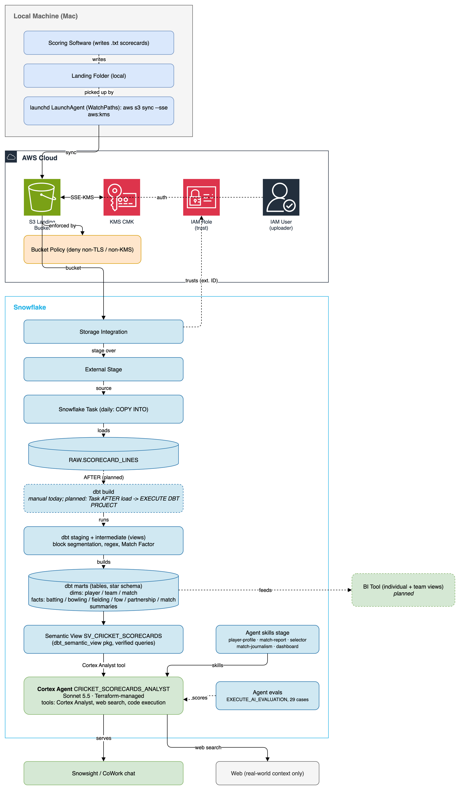
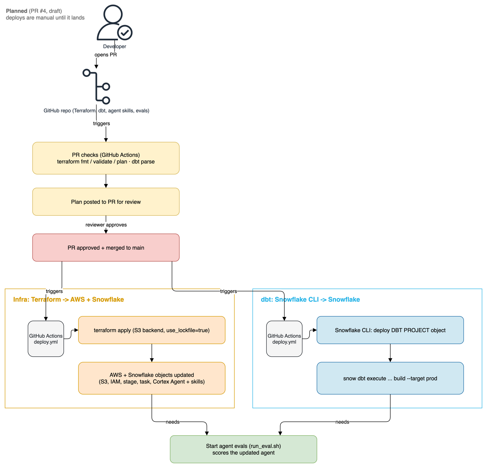

# Cricket Scorecard Data Pipeline

Ingests raw `.txt` cricket scorecards from a local landing folder into
Snowflake, parses them into a structured star schema, and serves them
through a Snowflake Semantic View to a Cortex Agent you can chat with in
Snowsight (and CoWork). Infra is managed with Terraform; transformation with
dbt; the agent is evaluated with Snowflake's native agent evaluations.

## Architecture



**Flow:** a local `launchd` job syncs scorecard files to an encrypted S3
bucket → a Snowflake storage integration/external stage reads from that
bucket → a scheduled Snowflake Task runs `COPY INTO` a raw table → `dbt
build` parses the raw text with SQL into staging, intermediate and mart
models → the marts feed a Snowflake Semantic View → the semantic view is
the Cortex Analyst tool of the `CRICKET_SCORECARDS_ANALYST` agent.

`dbt build` is currently run by hand; a dbt task chained `AFTER` the load
task is planned. No external orchestrator (Airflow, Step Functions) — see
[Decisions](#decisions).

## Cortex Agent

`CRICKET_SCORECARDS_ANALYST` answers questions about the 2026 simulated
season. Everything about it is in Terraform (`terraform/envs/prod/`):

- **Spec** — `agent_spec.yaml.tftpl`: response and orchestration
  instructions, sample questions, tools and skills. The orchestration model
  is pinned to `claude-sonnet-5-5` in `cortex_agent.tf`.
- **Tools** — Cortex Analyst over `SV_CRICKET_SCORECARDS` for every
  simulated-season figure; web search only for real-world background and
  history from before the simulation (simulated figures win, and the
  real-world record is signposted separately); code execution for the
  newspaper page and when a visual is asked for.
- **Skills** — `agent_skills/<name>/SKILL.md`, uploaded to the
  `AGENT_SKILLS` stage on apply: `player-profile`, `match-report`,
  `selector` (county players included for an international side),
  `match-journalism` (broadsheet articles and columns, laid out as a
  newspaper page) and `dashboard` (HTML dashboards, only on request).
- **Match Factor** — performance relative to the match average (1.0 =
  average). Pooled across matches by default; a single-match figure only
  for a question about one match, labelled "in this match". Newspaper
  copy uses traditional figures instead. See
  [docs/dbt-modeling-plan.md](docs/dbt-modeling-plan.md#advanced-metrics-match-factor).

Terraform updates the agent's live version directly, which is what
Snowsight and CoWork serve while no other version is committed. So don't
**Publish** it in Snowsight: that commits a version, and users would get
that frozen copy instead of later applies. To list it in CoWork, the owner
of `SNOWFLAKE_INTELLIGENCE_OBJECT_DEFAULT` runs `ALTER SNOWFLAKE
INTELLIGENCE ... ADD AGENT` once; otherwise open it from Snowsight → AI & ML
→ Agents.

### Evals

[evals/cortex_agent/](evals/cortex_agent/README.md) scores the live agent
with `EXECUTE_AI_EVALUATION`: 30 cases on behaviour (out-of-scope
questions, semantics, name resolution, simulated data vs web, skills,
dashboards) plus a few fixed facts that new data can't change. After an
apply:

```sh
SNOWFLAKE_DATABASE=<db> evals/cortex_agent/run_eval.sh --label <what> --wait -- -c <connection>
```

Run it two or three times and record before/after scores in the PR. A UAT
environment, where evals run before a change reaches prod, is the intended
next step.

## CI/CD



Planned, in draft (PR #4); deploys are manual until it lands. Two
independent pipelines, both triggered on merge to `main`:

1. **Infra pipeline** — `terraform apply` (S3 backend, native locking)
   updates AWS + Snowflake objects, including the agent and its skills,
   then starts an eval run against the updated agent.
2. **dbt deploy pipeline** — Snowflake CLI pushes the dbt project into the
   `DBT PROJECT` object; the next scheduled Task run picks up the new
   version automatically.

PRs run `terraform plan` and `dbt parse` only. Data correctness is covered
by dbt tests; agent behaviour by the evals.

## Decisions

| Area | Decision | Why |
|---|---|---|
| Local → S3 push | `launchd` agent with `WatchPaths` (not a fixed interval) | Fires immediately when a new scorecard file lands, no polling delay |
| AWS auth (uploader) | IAM user + scoped policy in Terraform; access key created out-of-band (`aws iam create-access-key`), stored in a gitignored local `.env` | Keeps the secret out of Terraform state entirely; rotation is manual (delete/recreate the key, update `.env`) |
| Object encryption | Upload script sends `--sse aws:kms` but never a specific key ID | The bucket's own default-encryption CMK is the single source of truth for which key is used — the script can't drift out of sync if the key is ever rotated |
| Terraform state locking | S3 native (`use_lockfile=true`), no DynamoDB | GA since Terraform 1.11 — one less resource, smaller IAM surface |
| Snowflake database | Existing database referenced by variable (see `terraform.tfvars`, gitignored); only a new `CRICKET_SCORECARDS_RAW` schema is created | Avoids Terraform owning a shared database it has no reason to manage, and avoids hardcoding an account-specific name in tracked code |
| Ingestion trigger | Scheduled `COPY INTO` via Snowflake Task (not Snowpipe), daily | Matches batch framing (scorecards arrive in batches, not continuously); no SQS/event infra |
| Warehouse | Existing warehouse referenced, not created | Already provisioned |
| Raw file parsing | Pure SQL in dbt (gaps-and-islands + regex), not Python/Snowpark | Prototyped and validated against a real sample file |
| dbt hosting | **dbt Projects on Snowflake** (native) | No Fargate/ECR/container infra; scheduled via `EXECUTE DBT PROJECT` |
| Mart materialisation | Marts as tables; staging and intermediate as views | Marts are queried repeatedly by the agent; views made a full build take ~17 minutes vs ~1 |
| Semantic layer | Snowflake Semantic Views via `dbt_semantic_view` package, with verified queries | Free, native, what Cortex Analyst actually reads |
| Match Factor | Per-match blend for single games; pooled over matches for periods | A zero-runs spell is rewarded rather than NULLed; pooling stops one freak match dominating a season |
| Agent deployment | Terraform updates the live agent; no committed versions | Git is the history; versions only add value once a UAT environment gates promotion |
| Agent model | Pinned to Sonnet 5.5 rather than `auto` | Orchestration only plans tool calls and writes the answer; ~⅓ faster than auto (Opus) with no real drop in eval scores |
| Agent skills | Defined in Terraform alongside the agent | They're part of the agent, so they deploy with it, not with the evals |
| Agent evals | Behaviour-focused cases against live data, plus a small fixed-fact subset | No frozen data clone or twin agent to maintain; data correctness belongs to dbt tests |
| Orchestration | None — Snowflake Task `AFTER` dependencies only | Two dependent steps in one system don't justify Airflow/Step Functions; MWAA runs ~24/7 regardless of load (~$358/mo base) |
| CI/CD | Two independent pipelines (infra via Terraform, dbt via Snowflake CLI) | Different systems, different failure domains — shouldn't block each other |

## Terraform resources

**AWS — implemented**
- `aws_s3_bucket` (+ versioning, public access block)
- `aws_kms_key` / `aws_kms_alias` (customer-managed key)
- `aws_s3_bucket_server_side_encryption_configuration` (default SSE-KMS)
- `aws_s3_bucket_policy` (deny non-TLS / non-KMS)
- `aws_iam_user` + scoped policy (uploader) — access key deliberately *not* managed here, see [Decisions](#decisions)
- `aws_iam_role` trusted by the Snowflake storage integration (two-pass apply — see `terraform/modules/snowflake-ingest/main.tf`)
- Backend: S3 with `use_lockfile = true`

**Snowflake — implemented**
- `snowflake_schema` (`CRICKET_SCORECARDS_RAW`) inside an existing database (referenced by variable, not hardcoded)
- `snowflake_storage_integration` + `snowflake_stage`
- `snowflake_file_format` (`FIELD_DELIMITER = 'NONE'` — whole line as one column)
- `snowflake_table` for `CRICKET_SCORECARDS_RAW.SCORECARD_LINES`
- `snowflake_task` (load task — daily `COPY INTO`; `started` set by variable)
- `snowflake_cortex_agent` (`CRICKET_SCORECARDS_ANALYST`)
- `snowflake_stage` + `snowflake_execute` for the agent's skills
- `snowflake_stage` + `snowflake_file_format` for the eval config
- `check` that web search is enabled on the account

**Snowflake — planned, not yet built**
- `snowflake_task` (dbt task — `AFTER` the load task)
- External access integration (for `dbt deps`)
- `snowflake_role` + grants (loader / dbt / agent users, separated)
- Migrate deprecated `snowflake_file_format`, `snowflake_stage` and `snowflake_storage_integration` to their replacement resources

## dbt project

- **Sources:** `CRICKET_SCORECARDS_RAW.SCORECARD_LINES`
- **Staging (views):** `stg_scorecard_lines`, `stg_blocks` (gaps-and-islands block segmentation), `stg_row_classification` (row-type detection)
- **Intermediate (views):** batting, bowling, fall-of-wickets and fielding rows; innings totals; partnerships; match header and result; batting and bowling Match Factor
- **Marts (tables):** `dim_player`, `dim_team`, `dim_match`, `fact_batting`, `fact_bowling`, `fact_fielding`, `fact_fow`, `fact_partnership`, `fact_player_match_summary`, `fact_team_match_summary`
- **Semantic layer:** `sv_cricket_scorecards` — the full star schema, season and period metrics (including pooled Match Factor) and verified queries for the questions expected most

Design and conventions: [docs/dbt-modeling-plan.md](docs/dbt-modeling-plan.md).

## Open items

- dbt task chained `AFTER` the load task, so new scorecards reach the marts without a manual build
- CI/CD (PR #4): post-deploy eval run; OIDC federation for the infra pipeline and a Snowflake key-pair service user for dbt deploys
- UAT environment for the agent, with evals gating promotion to prod
- Visual requests: Sonnet sometimes answers with Cortex Analyst's built-in chart instead of the dashboard skill
- Batting Match Factor: whether to blend like bowling (see the modeling doc)
- Roles and grants, including who can use the agent in CoWork

## Build order

1. ~~AWS module (S3 + KMS + IAM) — confirm local sync end to end~~ ✅
2. ~~Snowflake ingestion module (storage integration, stage, file format, raw table, load task)~~ ✅
3. ~~dbt staging and intermediate models~~ ✅
4. ~~dbt marts~~ ✅
5. ~~Semantic view + Cortex Agent, with evals~~ ✅
6. dbt task, chained `AFTER` the load task
7. CI/CD pipelines (PR checks, infra apply + evals, dbt deploy)
8. UAT environment for the agent
9. BI tool connection
